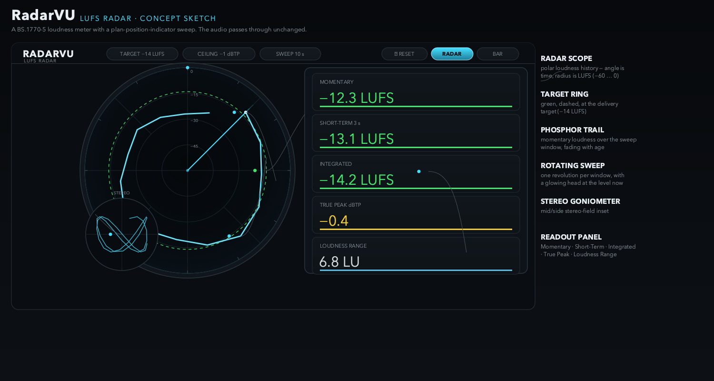
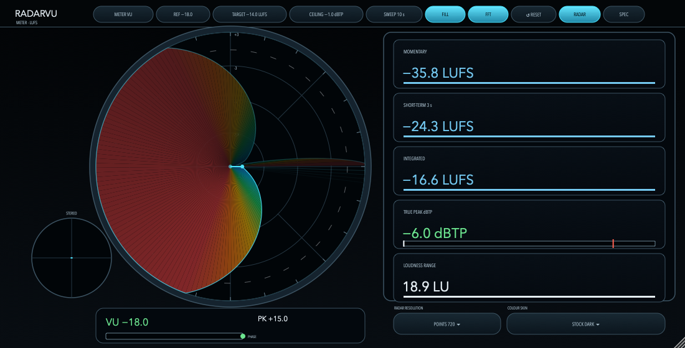
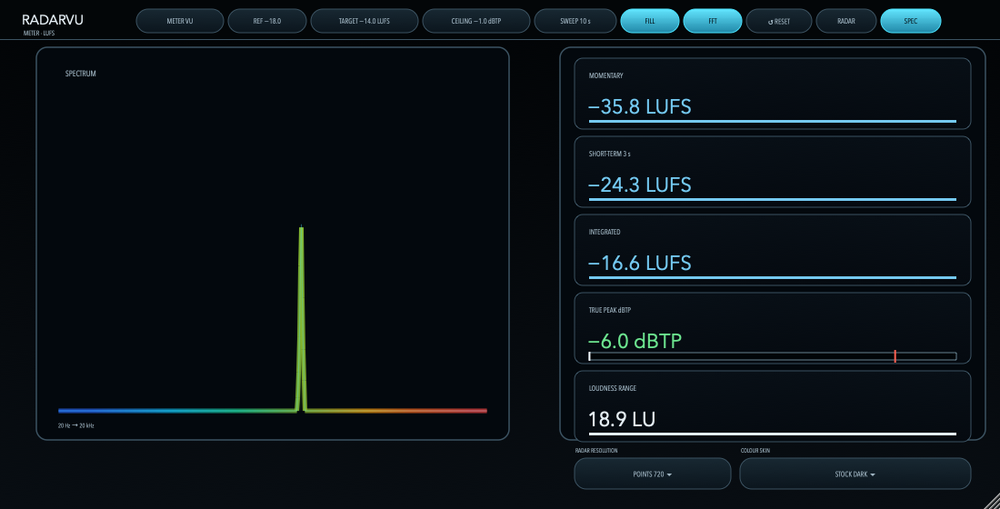
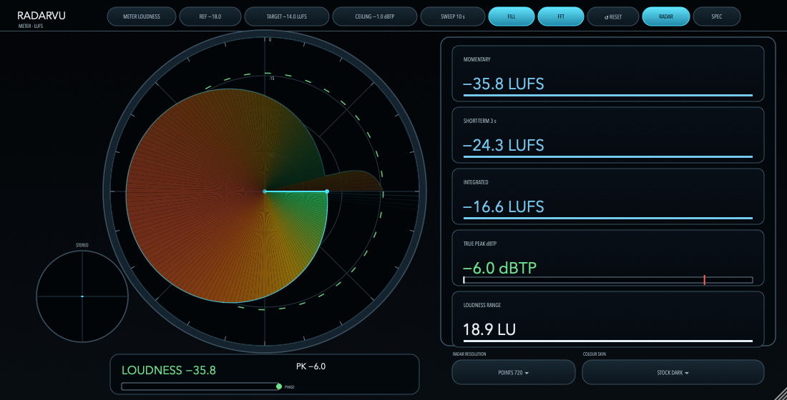
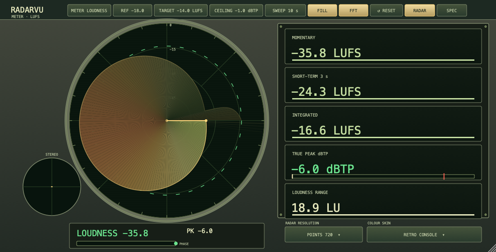
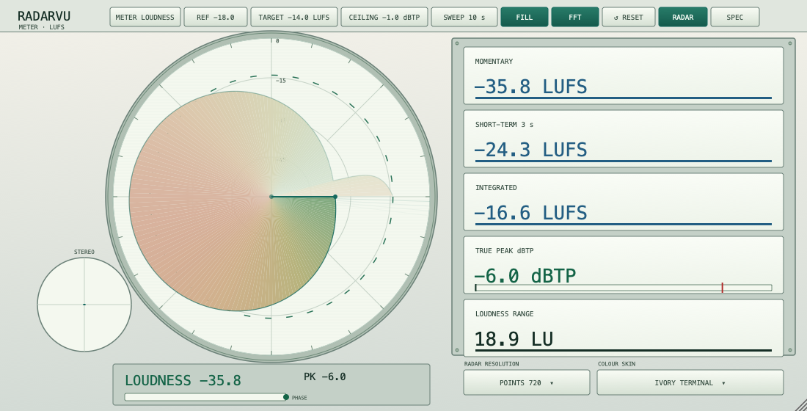
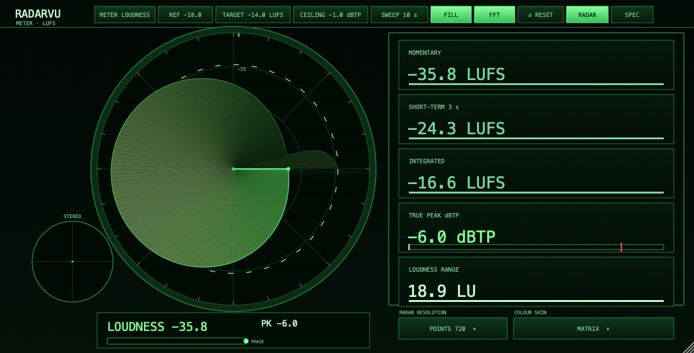
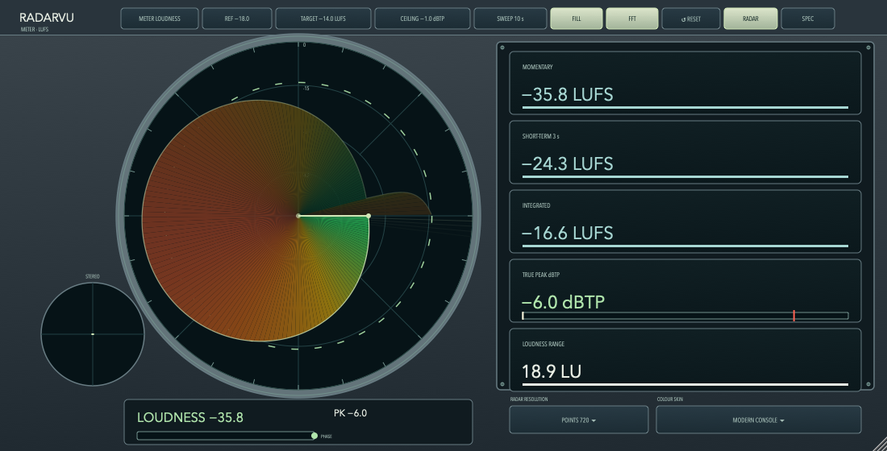
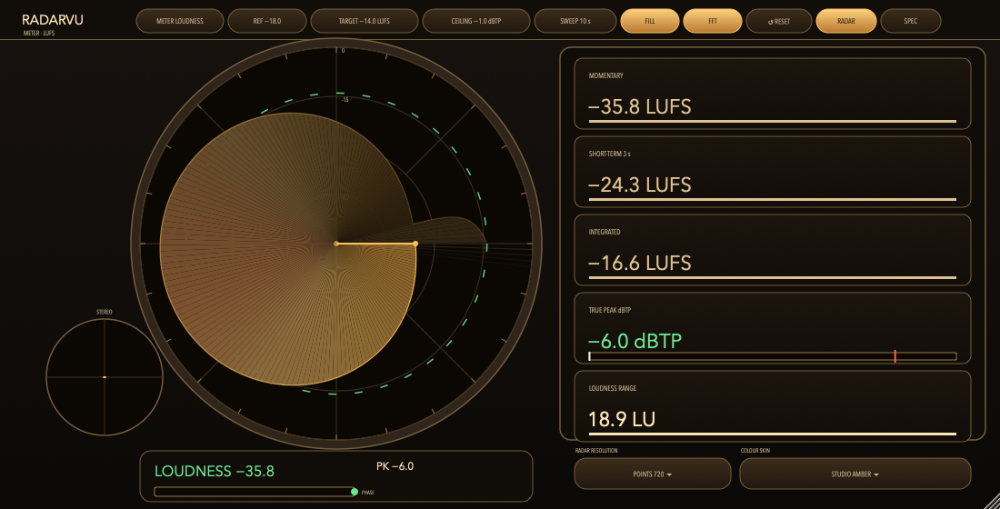

# RadarVU

**A full-set metering plugin with a polar radar display, by OpenGrid.** RadarVU carries ArcVu's measurement set — VU, RMS, K-12/K-14/K-20, DIN/Nordic/BBC/EBU peak-programme meters, peak + hold, and phase correlation — plus the BS.1770-5 loudness engine. The radar sweep plots the selected meter in polar coordinates (angle is time, radius is level), with a stereo goniometer inset. The audio passes through unchanged.



## Screenshots

| Radar mode | Spectrum mode |
|---|---|
|  |  |

*(Rendered by the offscreen UI audit harness from the actual plugin editor — see [qa/](qa/).)*

## The radar display

The centre of the face is a radar scope. The sweep rotates once per **window** (10 s by default), filling the scope with a multicolour heat-map of the selected meter's history:

- **Radius** is the selected meter's level, on that meter's own scale (VU −20…+3, RMS −40…+4 dBFS, K −24…+12, PPM per type, loudness −60…0 LUFS), with grid rings and labels.
- **Angle** is time, so the filled history is the last `window`, drawn as a comet that fades with age.
- The **POINTS** menu selects **180, 360, 720 (default), or 1440 points per revolution** (2°, 1°, 0.5°, or 0.25° spacing), sampled at their capture times independently of the host buffer size. A thin contour remains visible over the dimmed colour fill, or on its own with **FILL** off. In Loudness mode the trace follows the **400 ms momentary LUFS** measurement.
- The fill uses a continuous **heat ramp** suited to the selected skin, with a dashed ring at the 0 / reference point (or the delivery target in loudness mode). Warning readouts retain distinct green, amber and red states.
- A **STEREO** goniometer sits at 8 o'clock, to the lower-left of the scope, and a numeric readout under the scope shows the level, peak, over/clip and a phase-correlation gauge.
- The colour fill and the FFT can each be switched off from the header (**FILL** / **FFT** toggles).

The right-hand panel reads **Momentary**, **Short-Term**, **Integrated**, **True Peak** and **Loudness Range**. A **SPECTRUM** mode swaps the scope for a full multicolour FFT analyser (20 Hz → 20 kHz).

## Features

- **ArcVu's full measurement set.** VU (IEC 60268-17 galvanometer), RMS absolute dBFS with an AES-17 option, K-12/K-14/K-20, and the DIN/Nordic/BBC/EBU peak-programme meters (ITU-R BS.645-2, EBU Tech 3205-E with slow mode), plus digital peak + hold, a 3-sample over counter, clip, and a phase-correlation gauge.
- **Loudness to ITU-R BS.1770-5** (K-weighting, gating) with the EBU Tech 3341 time scales and Tech 3342 loudness range, and 4× oversampled true peak. The engine is the verified implementation shared with ArcVu and is checked against the EBU 3341/3342 calibration signals.
- **Radar and Spectrum display modes** — the radar is a filled multicolour polar history (deep-blue → cyan → green → amber → orange → red heat ramp), and Spectrum is a full multicolour FFT analyser. Both freely resizable, and the fill / FFT can be toggled off.
- **Clickable header** to pick the meter type (VU…EBU, Loudness), the reference (−20/−18/−14 dBFS), the loudness target (−23/−18/−16/−14 LUFS), true-peak ceiling (−1/−2/−3 dBTP) and sweep window (5/10/15/20/30 s), plus reset.
- **Resolution and skin menus** beneath the readouts choose the radar density and one of six colour skins. Both settings are host parameters, automate, and save with the project. Changing resolution starts a fresh trail while retaining loudness statistics; changing skin retains the trail. Older projects use 720 points and Stock Dark.
- **Layouts.** Mono and stereo. Surround and immersive layouts are not currently supported.
- **Formats.** VST3, Audio Unit, CLAP, LV2, AAX and Standalone on macOS; VST3, LV2 and Standalone elsewhere. AAX needs the Avid AAX SDK to build and is released only after PACE signing.

## Skins

All six skins cover Radar and Spectrum modes, including the controls and menus. The vintage and white terminals use monospaced typography, inset screens and subtle scanlines; Modern Console uses a slate hardware frame and pale phosphor trace.

| Stock Dark | Retro Console | Ivory Terminal |
|---|---|---|
|  |  |  |

| Matrix | Modern Console | Studio Amber |
|---|---|---|
|  |  |  |

## How it works

The detector and the drawing list are Rust (`dsp/`), using GoodLookinDri's `Scene` drawing commands. JUCE hosts the plug-in and replays the drawing list; the audio thread only pushes samples. The C ABI is `plugin/radarvu.h`.

## Build

```sh
cd RadarVU
cargo test --manifest-path dsp/Cargo.toml
cmake -S . -B build -DCMAKE_BUILD_TYPE=Release
cmake --build build --target RadarVU_VST3 -j 8
```

Rust (`cargo`) and a JUCE checkout next to this repository are required (JUCE at `../audiogridder/JUCE`). See [qa/PROJECT.md](qa/PROJECT.md) for the QA commands.

## Quality

The scope ledger is [qa/2026-10-29-radarvu/ledger.md](qa/2026-10-29-radarvu/ledger.md). The DSP crate's `cargo test` runs the EBU 3341/3342 calibration suite plus the detector calibration (VU, RMS, AES-17, K-12, PPM, correlation), the meter ballistics suite (VU and PPM response, calibration, sample-rate and block-size invariance), and radar history timing and drawing coverage plus resolution changes, skin invariance and text contrast — 52 tests.

With `RADARVU_BUILD_QA=ON`, the UI audit also accepts real stereo music:

```bash
build-qa/RadarVU_QA_artefacts/Release/RadarVU_QA /tmp/radarvu-music --music "/path/to/music.flac" 1 512 1100 frames
```

The trailing arguments select the sweep window index (0–4), audio block size, editor width, and optional frame export. It checks exact audio pass-through, state restoration, editor recreation and drawing limits, and records paint timings. After frame export, pass a VST3 bundle path (or `-` for the direct processor), then optional resolution (0–3) and skin (0–5) indices. Hosted runs test loading, audio, state and editor recreation; the native editor requires a separate host capture for visual verification. The default UI audit exports every skin in both modes at 440, 1100 and 4000 pixels, along with contact sheets.

## Licence

RadarVU is released by OpenGrid. See [LICENSE](LICENSE). JUCE is used under its own terms for the official binaries.
