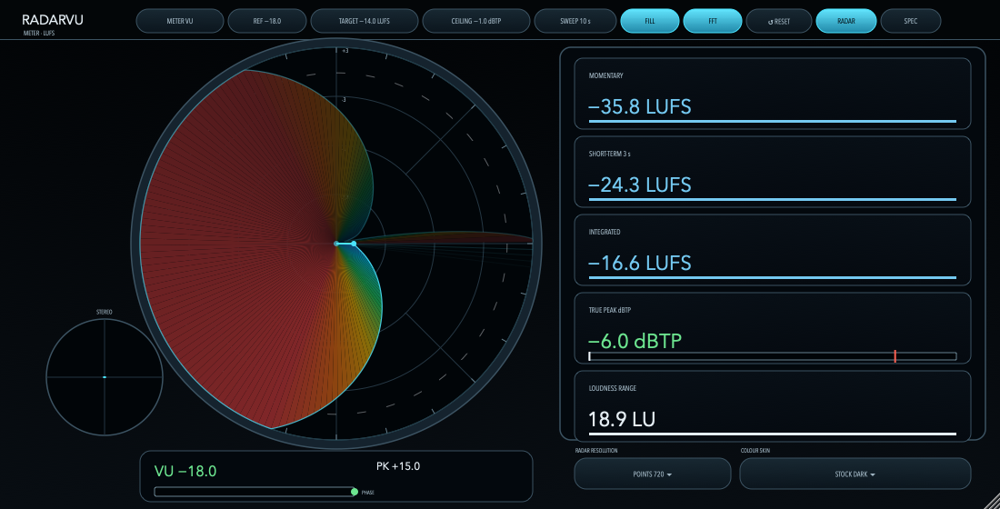
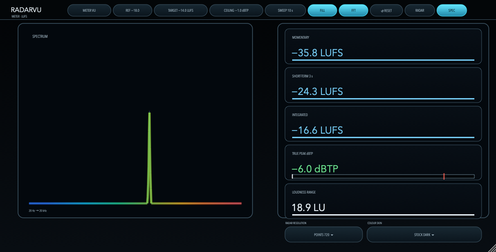

# RadarVU User Manual

A metering plug-in with a polar radar display: VU, RMS, K-System, peak-programme meters and BS.1770-5 loudness in one window. The audio passes through unchanged.

<!-- TOC -->

## Overview

RadarVU measures the signal and draws it. It never changes the sound: whatever goes in comes out, sample for sample, so you can leave it on any track or bus. It reads mono or stereo input.

The centre of the window is a **radar scope**. A sweep line turns once every **sweep window** (10 seconds by default). The distance from the centre is the level on the selected meter's own scale, and the angle is time, so the filled shape behind the sweep is the recent history of the signal.

## Installing and formats

RadarVU is available as VST3, Audio Unit (macOS), CLAP, LV2, AAX and a Standalone application. Install the formats your host uses. The plug-in reports company name OpenGrid in your host.

> AAX and Pro Tools are trademarks of Avid Technology, Inc.

## The window

### Header

Click a chip in the header to change it. METER, REF and SWEEP step to the next value on each click, and the last value wraps to the first. TARGET and CEILING open a menu instead.

| Chip | What it does |
|---|---|
| METER | Selects the meter: VU, RMS, K-12, K-14, K-20, DIN, Nordic, BBC, EBU or Loudness. |
| REF | Sets the reference level, in dBFS, that reads as 0 on the VU and peak-programme meters. |
| TARGET | Sets the loudness target shown as the dashed green ring and used to colour the loudness readings. Pick a preset (−24, −23, −18, −16, −14, −11 LUFS) or choose **Custom value…** and type any value from −40 to −6 LUFS, to 0.1. |
| CEILING | Sets the true-peak ceiling. The True Peak reading turns red above it. Pick a preset (−0.1, −0.5, −1, −2, −3 dBTP) or choose **Custom value…** and type any value from −6 to 0 dBTP, to 0.1. |
| SWEEP | Sets the sweep window: how many seconds one turn of the radar takes. |
| FILL | Switches the colour fill of the radar on or off. |
| FFT | Switches the spectrum analyser on or off. |
| RESET | Clears the readings: integrated loudness, loudness range, peak holds, over and clip counters, and the radar history. |
| RADAR / SPEC | Chooses the radar scope or the spectrum display. |

Two menus sit beneath the readouts. Click one to open it and pick a value:

| Menu | What it does |
|---|---|
| RADAR RESOLUTION | Sets the points per revolution: 180, 360, 720 (default) or 1440, which is 2°, 1°, 0.5° or 0.25° per point. Higher values draw a finer trace. Changing it starts a fresh radar trail but keeps the loudness statistics. |
| COLOUR SKIN | Chooses one of six skins: Stock Dark (default), Retro Console, Ivory Terminal, Matrix, Modern Console or Studio Amber. Changing it keeps the trail. |

The first six items (METER, REF, TARGET, CEILING, SWEEP and the RADAR / SPEC choice) and the two menus (RADAR RESOLUTION and COLOUR SKIN) are host parameters, so they can be automated and are saved with your project. Projects saved before the menus existed reopen with 720 points and Stock Dark. FILL and FFT are display switches and are not saved with the project.

### Radar scope

The radius is the selected meter's level. The rings are labelled in that meter's units. Colour follows level: blue when quiet, then cyan, green, amber, orange and red as the level rises. A dashed ring marks 0 (the reference) on the level meters, or the delivery target in Loudness mode. A bright head marks the level now, and an older part of the history fades with age.

The radar plots the louder of the two channels.

In Loudness mode the radar trace follows the 400 ms momentary loudness. A thin contour stays visible over the dimmed colour fill, and on its own when FILL is off.

### Skins

All six skins cover the radar and spectrum displays, the header chips and the menus. Retro Console, Ivory Terminal and Matrix use monospaced type and inset screens; Modern Console uses a slate frame with a pale trace; Studio Amber is a warm dark skin. Warning readouts keep distinct green, amber and red states in every skin. Screenshots of each skin are in the README.

### Stereo goniometer

The small circle at the lower left shows the stereo image as a mid/side trace. The horizontal axis is mid (what the channels share) and the vertical axis is side (how they differ). A mono signal draws a horizontal line; a wide stereo signal spreads the trace up and down.

### Level readout and phase gauge

Under the scope, a numeric readout shows the selected meter's level, the peak, the over and clip counters, and a phase gauge. The gauge reads 0 for a mono-compatible signal, about −20 for uncorrelated channels and down to −39 for channels in opposite polarity.

### Loudness panel

The panel on the right reads Momentary (400 ms), Short-Term (3 s), Integrated, True Peak and Loudness Range. These follow ITU-R BS.1770-5 and EBU Tech 3341 and 3342. Integrated loudness and loudness range keep accumulating until you press RESET.

## Meters

| Meter | What it shows |
|---|---|
| VU | A VU meter response (IEC 60268-17): the average level, reaching 99 percent of a steady tone in about 0.3 seconds, with a small overswing. |
| RMS | The RMS level in dBFS over a 300 ms window. |
| K-12, K-14, K-20 | The RMS level relative to the K-System reference (0 at −12, −14 or −20 dBFS RMS). |
| DIN, Nordic | Peak-programme meters (Type I) with a 5 ms integration time. |
| BBC | A peak-programme meter (Type IIa) with a 10 ms integration time. |
| EBU | A peak-programme meter (EBU Tech 3205) with a 10 ms integration time. |
| Loudness | Momentary loudness in LUFS on a scale from −60 to 0. |

On the level meters, 0 is the REF setting.

## Notes

- RadarVU has no input or output controls. It is a pass-through meter and does not change the level or the routing.
- The numeric readouts show the live detector value. The peak value is held for a few seconds so it can be read.
- Switching the meter type clears the radar history so two scales never share one trail.

<!-- PARAMETERS -->

## Version

This manual describes RadarVU 1.0.1. See the changelog for what changed since 1.0.0.
